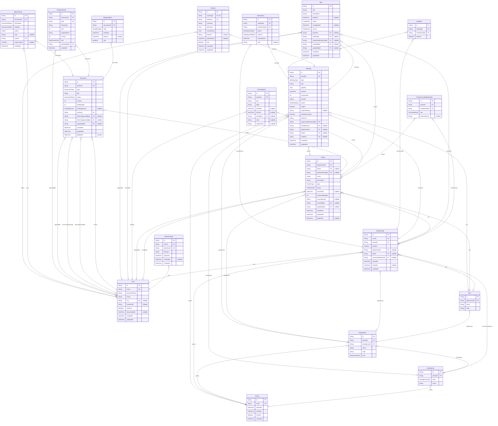

# Quorum

> Generated by [`prisma-markdown`](https://github.com/samchon/prisma-markdown)

- [default](#default)

## default

### `User`

A login account. Users are deactivated, never deleted, so history keeps its authors.

Properties as follows:

- `id`:
- `email`:
- `passwordHash`:
- `name`:
- `nrp`:
- `avatarPath`:
- `isAdmin`:
- `deactivatedAt`:
- `createdAt`:
- `updatedAt`:

### `RefreshToken`

Only the hash is stored. All tokens issued from one login share a familyId, so reuse of a
revoked token can revoke the whole family.

Properties as follows:

- `id`:
- `userId`:
- `tokenHash`:
- `familyId`:
- `expiresAt`:
- `revokedAt`:
- `createdAt`:

### `Period`

One cabinet term. Exactly one is active (partial unique index in the migration).

Properties as follows:

- `id`:
- `name`:
- `startDate`:
- `endDate`:
- `isActive`:
- `createdAt`:

### `Kesekjenan`

Properties as follows:

- `id`:
- `periodId`:
- `code`:
- `name`:

### `Department`

Properties as follows:

- `id`:
- `periodId`:
- `kesekjenanId`:
- `name`:
- `code`:
- `kind`:

### `Biro`

Properties as follows:

- `id`:
- `departmentId`:
- `name`:
- `code`:

### `Membership`

A user's position in one period. Which unit field is set depends on the position
(rules in data-model.md, enforced by the org service). One active membership per user per
period is a partial unique index in the migration.

Properties as follows:

- `id`:
- `userId`:
- `periodId`:
- `position`:
- `departmentId`:
- `biroId`:
- `coversKesekjenanId`:
- `startedAt`:
- `endedAt`:
- `createdAt`:

### `Proker`

Work program. Soft-deleted (deletedAt); lists exclude deleted rows by default.

Properties as follows:

- `id`:
- `departmentId`:
- `biroId`:
- `picMembershipId`:
- `name`:
- `description`:
- `type`:
- `status`:
- `eventDate`:
- `estimatedBudget`:
- `cancelReason`:
- `createdById`:
- `updatedById`:
- `createdAt`:
- `updatedAt`:
- `deletedAt`:

### `ProkerCommitteeMember`

Properties as follows:

- `id`:
- `prokerId`:
- `membershipId`:
- `role`:
- `divisionName`:

### `ChecklistItem`

Generated from the proker type's template; `key` identifies the template step.

Properties as follows:

- `id`:
- `prokerId`:
- `key`:
- `label`:
- `dueDate`:
- `doneAt`:
- `doneById`:
- `note`:
- `evidenceUrl`:

### `Task`

A task comes from a proker or from a meeting's next action (source).

Properties as follows:

- `id`:
- `title`:
- `description`:
- `deadline`:
- `status`:
- `completedAt`:
- `source`:
- `prokerId`:
- `meetingId`:
- `assigneeMembershipId`:
- `createdById`:
- `updatedById`:
- `createdAt`:
- `updatedAt`:

### `Document`

Proposal or LPJ. Soft-deleted; one live document per (proker, type) via a partial unique index.
REVIEWED requires both approvals; returning to REVISION clears both.

Properties as follows:

- `id`:
- `prokerId`:
- `type`:
- `title`:
- `status`:
- `version`:
- `totalBudget`:
- `fundingSource`:
- `authorId`:
- `adminApprovedById`:
- `financeApprovedById`:
- `updatedById`:
- `createdAt`:
- `updatedAt`:
- `deletedAt`:

### `StepDeadline`

H-n deadline of one workflow step, computed from the proker's event date.

Properties as follows:

- `id`:
- `documentId`:
- `step`:
- `dueDate`:
- `doneAt`:
- `late`:

### `FileAttachment`

Uploaded file metadata. `path` is server-generated; originalName is display-only.

Properties as follows:

- `id`:
- `documentId`:
- `path`:
- `mimeType`:
- `size`:
- `originalName`:
- `version`:
- `kind`:
- `uploadedById`:
- `createdAt`:

### `ApprovalLog`

Append-only history of document transitions.

Properties as follows:

- `id`:
- `documentId`:
- `fromStatus`:
- `toStatus`:
- `action`:
- `note`:
- `actorId`:
- `actorPosition`:
- `createdAt`:

### `Meeting`

The scope fields (department/biro/kesekjenan/proker) that are set depend on the meeting type.
agenda JSON: [{ topic, expectedOutput, materials }].

Properties as follows:

- `id`:
- `periodId`:
- `type`:
- `title`:
- `agenda`:
- `startsAt`:
- `durationMin`:
- `location`:
- `status`:
- `urgent`:
- `urgentReason`:
- `attendanceOpen`:
- `qrSecret`:
- `organizerMembershipId`:
- `kesekjenanId`:
- `departmentId`:
- `biroId`:
- `prokerId`:
- `createdAt`:
- `updatedAt`:

### `Minutes`

decisions JSON: [{ text }]; carriedOver JSON: [{ topic }]. Next actions become Task rows.

Properties as follows:

- `id`:
- `meetingId`:
- `authorId`:
- `summary`:
- `decisions`:
- `carriedOver`:
- `filePath`:
- `publishedAt`:
- `late`:
- `createdAt`:
- `updatedAt`:

### `Invitation`

Properties as follows:

- `id`:
- `meetingId`:
- `membershipId`:
- `optional`:

### `Attendance`

Properties as follows:

- `id`:
- `meetingId`:
- `membershipId`:
- `status`:
- `method`:
- `checkedInAt`:
- `note`:
